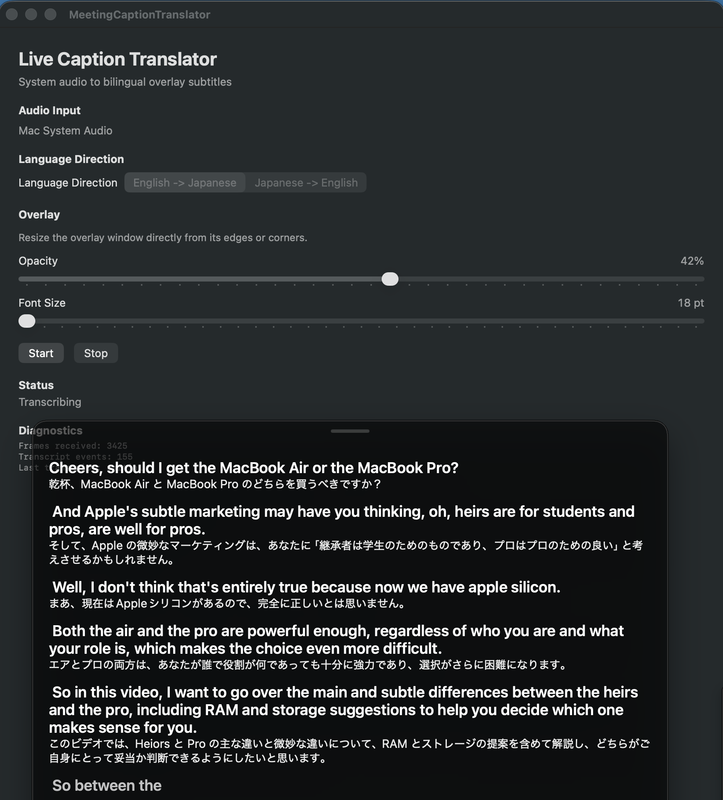

# MeetingCaptionTranslator

Mac のシステム音声またはマイクの音声を文字起こしし、英語と日本語の字幕を常に手前に表示する macOS アプリです。オンライン会議や動画を見ながら、元の発話と翻訳を確認できます。



## できること

- Mac のシステム音声、または選択したマイクから音声を取得する
- 英語 → 日本語、日本語 → 英語の字幕を表示する
- 音声認識に Apple Speech またはローカルの speech.cpp を選ぶ
- 字幕オーバーレイのサイズ、文字サイズ、背景の透明度を調整する

翻訳には Apple の Translation framework を使用します。認識結果や翻訳の精度、字幕が表示されるまでの時間は、話者、言語、音声環境、選んだ認識エンジンによって変わります。

## 必要な環境

- macOS 26 以降
- macOS 26 SDK を含む Xcode
- インストール用: Ruby、Git、CMake 3.20 以降、C++17 対応コンパイラ
- モデルの初回ダウンロード用のインターネット接続と空き容量

Apple Speech と Translation の利用可能な言語やモデルは macOS の環境に依存します。開発時に Xcode プロジェクトを再生成するには Bundler も必要です。

## インストール

リポジトリを取得し、インストールスクリプトを実行します。

```bash
git clone https://github.com/terasakisatoshi/MeetingCaptionTranslator.git
cd MeetingCaptionTranslator
ruby tools/install_app.rb
```

スクリプトは speech.cpp をビルドし、Haas-ja（約 0.66 GB）と Qwen3-ASR 0.6B（約 0.84 GB）をダウンロードしてから、アプリをビルドし、`/Applications/MeetingCaptionTranslator.app` にインストールします。初回は時間がかかります。環境に応じて Xcode の署名設定と `/Applications` への書き込み権限が必要です。

ビルド成功後、起動中の MeetingCaptionTranslator は強制終了され、インストール済みのアプリは置き換えられます。モデルの準備またはビルドに失敗した場合は、インストール済みのアプリを変更しません。

## 使い方

1. MeetingCaptionTranslator を起動します。
2. **Audio Input** で `Mac System Audio` または `Microphone` を選びます。マイクの場合は、システムの既定入力または一覧からデバイスを選べます。
3. **Language Direction** で `English -> Japanese` または `Japanese -> English` を選びます。
4. **Speech Recognition** で Apple Speech または speech.cpp のモデルを選びます。Apple Speech のモデルは `Download Apple Speech Model` で事前に準備できます。
5. **Start** を押し、必要な権限を許可します。停止するには **Stop** を押します。

字幕ウィンドウは端や角をドラッグしてサイズを変更できます。コントロールウィンドウの **Opacity** と **Font Size** で見た目を調整できます。言語方向と音声認識エンジンは停止中に変更でき、選択は保存されます。既定の入力はシステム音声、既定の言語方向は英語 → 日本語、既定の音声認識エンジンは Apple Speech です。

### macOS の権限

初回使用時には、選択した機能に応じて次の権限を許可してください。

| 権限 | 必要な場合 |
| --- | --- |
| System Audio Recording | Mac のシステム音声を取得するとき |
| Microphone | マイクを使用するとき |
| Speech Recognition | Apple Speech を使用するとき |

権限を拒否した場合は、macOS の「システム設定」→「プライバシーとセキュリティ」で該当する権限を確認してください。

## 音声認識モデル

| 入力言語 | Apple Speech | speech.cpp |
| --- | --- | --- |
| 英語 → 日本語 | 英語モデル | Qwen3-ASR 0.6B |
| 日本語 → 英語 | 日本語モデル | Haas-ja |

### Apple Speech

`Download Apple Speech Model` は、選択中の入力言語のモデルを確認し、必要なら macOS 経由でダウンロード・インストールします。準備中はスピナーが表示され、完了後に `Apple Speech model is ready.` と表示されます。すでにモデルがある場合もこのボタンで確認できます。

事前準備を行わずに `Start` を押した場合も、必要なモデルの準備を試みます。初回の取得にはインターネット接続が必要です。モデルは macOS が管理するため、利用できる言語や取得結果は環境によって異なります。

### speech.cpp

インストールスクリプトは両方のモデルを事前に取得します。手動ビルドなどでモデルがない場合は、初回使用時にダウンロードと読み込みが必要です。認識はローカルで実行されます。

speech.cpp の字幕は発話の切れ目で確定します。音量による簡易的な発話検出を使用するため、静かな声や騒音環境では音声が途切れたり、字幕の表示が遅れたりすることがあります。

## 困ったときは

- **字幕が出ない:** `Audio Input`、入力デバイス、システム音声またはマイクの権限を確認してください。画面の **Status** と **Diagnostics**、エラーメッセージも確認できます。
- **Apple Speech の準備が終わらない、または失敗する:** インターネット接続と入力言語を確認し、`Download Apple Speech Model` を再試行してください。モデルの利用可否は macOS 環境に依存します。
- **speech.cpp が見つからない:** インストールスクリプトを実行するか、開発時は `tools/build_speech.sh` を実行してからアプリを再ビルドしてください。
- **翻訳を開始できない:** macOS の翻訳言語データと画面に表示されたエラーを確認してください。
- **権限を何度も求められる:** 実行用のアプリに Xcode で Team と署名 ID を設定してください。未署名ビルドは権限の動作確認に適していません。

## プライバシー

アプリは `Start` から `Stop` までの間、選択された音声入力を取得します。アプリ自身は取得した音声をファイルに保存しません。字幕履歴は実行中のメモリ内に保持され、最大 500 行です。言語方向や表示設定などは保存されます。

このリポジトリの実装には、開発者が運用する外部サーバー、外部 API キー、独自の認証情報は含まれていません。Apple の各 framework による処理は、macOS 環境と framework の動作に従います。モデルのダウンロードにはネットワークを使用します。

## 開発

### セットアップ

```bash
bundle install
bundle exec ruby tools/generate_project.rb
```

ソースファイルを追加または削除した後も、`tools/generate_project.rb` を再実行してください。Xcode で `MeetingCaptionTranslator.xcodeproj` を開いて実行する場合は、`Signing & Capabilities` で Team と署名 ID を設定します。Bundle Identifier を変更する場合は `tools/generate_project.rb` の `PRODUCT_BUNDLE_IDENTIFIER` を編集してプロジェクトを再生成します。変更後は macOS の権限を再付与する必要があります。

### ビルドとテスト

```bash
xcodebuild build \
  -project MeetingCaptionTranslator.xcodeproj \
  -scheme MeetingCaptionTranslator \
  -destination 'platform=macOS' \
  CODE_SIGNING_ALLOWED=NO
```

```bash
xcodebuild test \
  -project MeetingCaptionTranslator.xcodeproj \
  -scheme MeetingCaptionTranslatorTests \
  -destination 'platform=macOS' \
  CODE_SIGNING_ALLOWED=NO
```

これらは署名を無効にしたビルド・テスト用コマンドです。実際の音声取得や権限の確認には、署名済みアプリを使用してください。アプリは Core Audio tap によるシステム音声の取得のため、App Sandbox を無効にしています。

### リリース成果物と speech.cpp

```bash
tools/build_speech.sh
ruby tools/build_release.rb
```

`build_speech.sh` は固定された speech.cpp 0.9.4 をソースからビルドします。続くアプリビルドでは、生成した `speech` 実行ファイルをアプリに同梱します。ビルドは実行した Mac の CPU 向けです。別アーキテクチャで使用する場合は、その環境で speech.cpp をビルドしてください。`build_release.rb` は成果物を `dist/MeetingCaptionTranslator.app` にコピーし、既存の `dist` ディレクトリを置き換えます。

`speech` が同梱されていない場合、アプリは `~/.local/bin/speech`、`/opt/homebrew/bin/speech`、`/usr/local/bin/speech` の順に外部インストールを探します。

### ディレクトリ構成

| パス | 内容 |
| --- | --- |
| `MeetingCaptionTranslator/App/` | アプリのエントリーポイントと操作画面 |
| `MeetingCaptionTranslator/Models/` | 設定や字幕などの値型 |
| `MeetingCaptionTranslator/Services/` | 音声取得、認識、翻訳、字幕処理、設定保存 |
| `MeetingCaptionTranslator/ViewModels/` | 状態管理と画面への受け渡し |
| `MeetingCaptionTranslator/Views/`、`Infrastructure/` | オーバーレイ表示とウィンドウ管理 |
| `MeetingCaptionTranslatorTests/` | XCTest テスト |
| `tools/` | プロジェクト生成、ビルド、インストールのスクリプト |
| `docs/plans/` | 設計・実装メモ |

## 謝辞

音声認識には [speech.cpp](https://github.com/nyosegawa/speech.cpp) を使用しています。開発者と貢献者の皆さまに感謝します。

## ライセンス

[MIT License](LICENSE)

### GitHub Actions でのインストール検証

`Verify installation` ワークフローは push、プルリクエスト、手動実行で起動します。macOS 26 の GitHub-hosted runner でテストを実行し、上記のインストールスクリプトによる speech.cpp のビルド、両モデルのダウンロード、アプリのビルドと `/Applications` への配置を確認します。CI のアプリは署名を無効にしているため、署名・公証や音声入力の権限、実際の字幕表示はこのワークフローの検証対象には含まれません。
